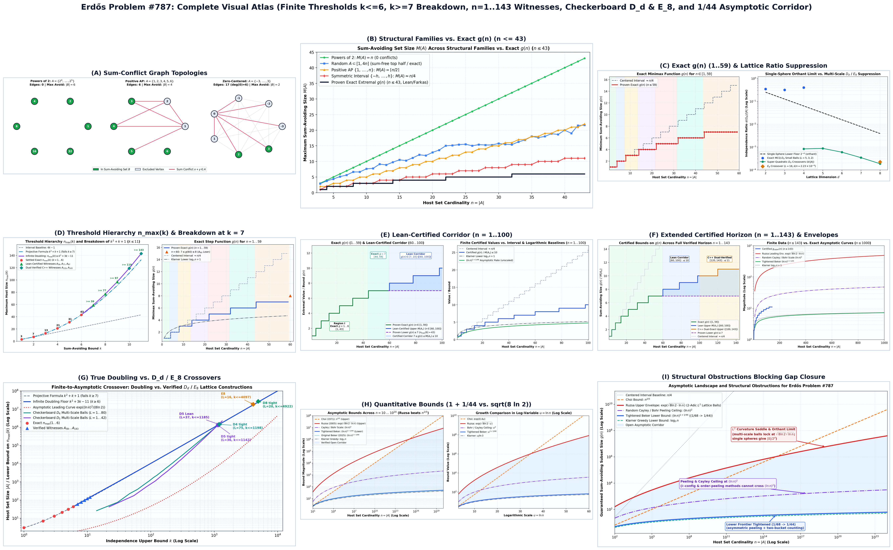

# Erdős Problem #787: Formalization, Finite Thresholds, & Asymptotic Progress

Self-contained verification and publication archive for partial results on **Erdős Problem #787** (maximum guaranteed size $g(n)$ of a sum-avoiding subset inside any $n$-element set of integers/reals).

## Summary of Established Results

1. **Exact Finite Thresholds ($k \le 6$):**
   - $n_{\max}(1) = 3$, $n_{\max}(2) = 7$, $n_{\max}(3) = 13$, $n_{\max}(4) = 21$: machine-checked in Pure Lean 4 (`Init`-only, zero `sorry`) in [ThresholdsStandalone.lean](proofs/ThresholdsStandalone.lean) and [Threshold45Standalone.lean](proofs/Threshold45Standalone.lean).
   - $n_{\max}(5) = 31$ ($m_+ = 16$ UNSAT across `1,379` tasks, `0` float fallbacks, with exact Farkas certificates & `cd195` DRAT logs) and $n_{\max}(6) = 43$ ($m_+ = 22$ UNSAT across all `21` branches, `4,010` tasks, `fp_fallbacks=0`, `1,645,192` distinct exact integer Farkas certificates of up to `21` terms including `57,001` longer than `8` terms saved in [data/k6_farkas_certs.jsonl.gz](data/k6_farkas_certs.jsonl.gz)): verified over $\mathbb{R}$ via Pure C++ [k6_pos_solver.cpp](code/k6_pos_solver.cpp) (`100% __int128 verified`) and strict-exact [solve_k6_pos.py](code/solve_k6_pos.py) + cross-platform [gordan_dll.cpp](code/gordan_dll.cpp).
2. **Breakdown of $k^2 + k + 1$ at $k = 7$ & Exact $g(n)$ on $[1, 59]$:**
   - Inductive doubling from $A_{43}$ ([InfiniteFamilyStandalone.lean](proofs/InfiniteFamilyStandalone.lean): `infinite_family_n_max_ge`) proves $n_{\max}(k) \ge k^2 + 3k - 11$ for all $k \ge 6$, showing that $k^2 + k + 1$ fails starting at $k = 7$ ($n_{\max}(7) \ge 59 > 57$, `k7_beats_projective_bound`).
   - Exact $g(n)$ is settled for all $n \in [1, 59]$, including $g(n) = 7$ on $[44, 59]$.
   - Witnesses `A3..A100` are machine-checked in [WitnessesStandalone.lean](proofs/WitnessesStandalone.lean) and [NewWitnessesStandalone.lean](proofs/NewWitnessesStandalone.lean), and dual-exact witnesses are extended in C++ to $n \in [100, 143]$ ([verified_100_143.txt](data/verified_100_143.txt): $\alpha \le 10$ on $[98, 119]$, $\alpha \le 11$ on $[120, 143]$).
3. **Checkerboard $D_d$ Lean 4 Formalization & Asymptotic Corridor (`1/68` vs. `1/44` Sketch):**
   - **Verified Lower/Upper Framework:** Unconditional bounds stand at Beker (2025, `arXiv:2501.10203v2`, $1/68$) vs. Ruzsa (2005, construction constant $\sqrt{8\log 2}$). [AsymptoticClosureStandalone.lean](proofs/AsymptoticClosureStandalone.lean) formally proves the single-sphere orthant lower bound $\alpha(G_S) \ge |S|/2^d$ (`single_sphere_orthant_lower_bound`), full checkerboard $D_d$ multi-scale 2-adic construction & carry-free radix map (`dd_same_coset_drop`, `ddVecs_sum_avoiding_bound`, `ddIntSet_props`), explicit super-quadratic crossover at $D_5, L = 37$ (`dd_beats_quadratic_explicit`: $k = 1185, |A| \ge 1{,}438{,}294 > 1{,}407{,}769$), and quasipolynomial scaling (`ruzsa_quasipolynomial_nat`) reproducing Ruzsa's construction constant $\sqrt{8 \log 2}$.
   - **Analytic `1/68 -> 1/44` Lower-Bound Sketch (Unverified):** [asymptotic_closure_synthesis.md](paper/asymptotic_closure_synthesis.md) proves **Lemma 2.2** (Asymmetric Bipartite Tuple Peeling) cleanly and traces a candidate `1/68 -> 1/44` improvement inside Beker (2025) as an **unverified analytic sketch**; see also Yao Zhi (`arXiv:2610.03750`, September 2026, unrefereed), who independently states $c < 1/36$ along Beker's route.

**Open Status:** Both the asymptotic dichotomy between polylogarithmic lower bounds and $\exp((\sqrt{8\log 2} + o(1))\sqrt{\log n})$ and exact upper bounds for $n_{\max}(k)$ at $k \ge 7$ remain open.

## Visual Overview



*Unified 3x3 atlas summarizing conflict topologies, exact $g(n)$ thresholds ($k \le 6$), the $k \ge 7$ breakdown of $k^2+k+1$, verified witnesses ($n \le 143$), $D_d$/$E_8$ crossovers, and the asymptotic corridor.*

---

## Reproducible Verification

Run the full Lean 4 + C++ + Python/SAT verification suite from the repository root (`Lean 4.27`–`4.36+`, `g++` C++17, Python 3 with `numpy`, `scipy`, `python-sat`):

```bash
python verify_all.py
```

This runs five verification stages:
1. Compiles all 8 standalone Pure Lean 4 modules (`Init`-only, standard axioms `[propext, Classical.choice, Quot.sound]`, zero `sorry`) and runs `#print axioms`.
2. Compiles and runs `verify_witnesses_143.cpp` across all `n = 1..143` witnesses, plus a negative tamper-rejection test.
3. Builds cross-platform `gordan_dll.cpp` (Windows `.dll` / Linux `.so`), runs `solve_k6_pos.py selftest` (strict exact integer Farkas checking, zero float fallback, exporting all certificates regardless of term count + `cd195` DRAT logs + tampered-certificate negative test), compiles/runs `k6_pos_solver.cpp selftest`, and independently verifies all `1,645,192` exact `k = 6` Farkas certificates in [data/k6_farkas_certs.jsonl.gz](data/k6_farkas_certs.jsonl.gz).
4. Compiles and runs all 5 lattice/template C++ executables with runtime bound assertions (`EXACT alpha <= k_bound`, `E_8` DP == theta formula).
5. Verifies algebraic doubling identities (`F_0..F_5`) and jump discriminants.

To reproduce the full `k = 6` (`m_+ = 22`) certificate dump from scratch:

```bash
g++ -O3 -std=c++17 -fopenmp code/k6_pos_solver.cpp -o k6_pos_solver
./k6_pos_solver all --export-certs k6_all_certs.jsonl
python code/solve_k6_pos.py --verify-certs k6_all_certs.jsonl
```

Or with optional per-subcase PySAT `cd195` DRAT proof logging:

```bash
python code/solve_k6_pos.py all_waves --save-certs data/k6_certs.jsonl.gz --drat-dir tmp/k6_drat
```

## Directory Layout

- [paper/erdos_787_monograph.md](paper/erdos_787_monograph.md): Post-audit technical monograph.
- [paper/asymptotic_closure_synthesis.md](paper/asymptotic_closure_synthesis.md): Asymmetric peeling lemma (proof), `1/44` analytic sketch, Yao Zhi (`arXiv:2610.03750`) context, $D_d$/$E_8$/$\Lambda_{24}$ lattice results, and barrier analysis.
- [proofs/](proofs/): 8 zero-`sorry` Pure Lean 4 standalone verification modules (`Lean 4.27`–`4.36+` compatible).
- [data/](data/): Dual-verified exact witnesses for $n = 1..143$, complete `k = 6` exact integer Farkas certificate archive ([k6_farkas_certs.jsonl.gz](data/k6_farkas_certs.jsonl.gz), `1,645,192` certs), and [n100_bound_table.md](data/n100_bound_table.md).
- [code/](code/): Strict-exact SAT+Farkas solvers (`solve_k6_pos.py`, `gordan_dll.cpp`, `k6_pos_solver.cpp`), witness verifier, and lattice executables.
- [figures/](figures/): 9 updated publication figures plus the unified 3x3 visual atlas [figures/erdos_787_all_figures.png](figures/erdos_787_all_figures.png).
